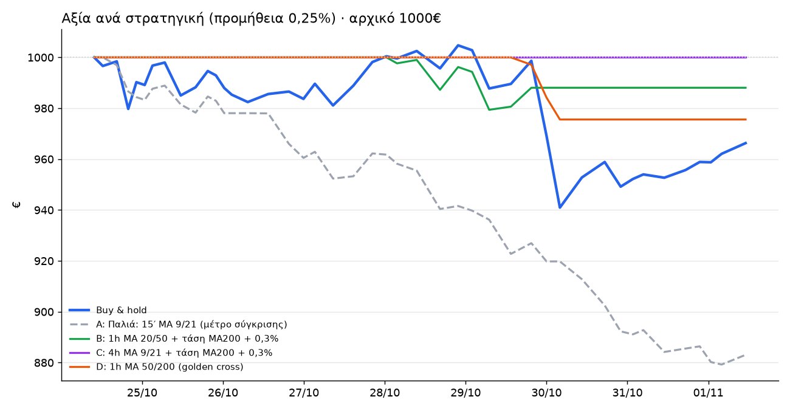

# 📈 Paper trading: αποτελέσματα

**Ενημέρωση:** 04/11/2026 05:20 · **Έναρξη:** 2026-10-24 09:47 · **Κεφάλαιο:** 1000€ ψεύτικα ανά στρατηγική (μισά BTC, μισά ETH)

> Buy & hold: **935.08€ (-6.49%)** · Καλύτερη στρατηγική τώρα: **C** με 1000.00€ (+0.00%), πάνω από το buy & hold

| | Στρατηγική | Αξία @0,25% | Αξία @0,09% | Trades | Κερδοφόρα | Προμήθειες @0,25% | Max DD | Θέση BTC / ETH |
|---|---|---:|---:|---:|---:|---:|---:|---|
| **A** | Παλιά: 15′ MA 9/21 (μέτρο σύγκρισης) | 843.74€ (-15.63%) | 915.54€ (-8.45%) | 102 | 3/51 (6%) | 117.39€ | -15.6% | ⚪ έξω / ⚪ έξω |
| **B** | 1h MA 20/50 + τάση MA200 + 0,3% | 972.26€ (-2.77%) | 976.90€ (-2.31%) | 6 | 1/3 (33%) | 7.38€ | -2.8% | ⚪ έξω / ⚪ έξω |
| **C** | 🏆 4h MA 9/21 + τάση MA200 + 0,3% | 1000.00€ (+0.00%) | 1000.00€ (+0.00%) | 0 | - | 0.00€ | 0.0% | ⚪ έξω / ⚪ έξω |
| **D** | 1h MA 50/200 (golden cross) | 975.58€ (-2.44%) | 977.10€ (-2.29%) | 2 | 0/1 (0%) | 2.44€ | -2.4% | ⚪ έξω / ⚪ έξω |
| | Buy & hold | 935.08€ (-6.49%) | | 0 | | 0€ | -6.9% | 🟢 / 🟢 |

**Πώς διαβάζεται:** «@0,25%» = με προμήθεια Kraken, «@0,09%» = με προμήθεια Revolut X (taker). Τα σήματα είναι ίδια, αλλάζει μόνο το κόστος. Max DD = μεγαλύτερη πτώση από κορυφή.

Συναλλαγές: `paper_trades.csv` · Αξία στον χρόνο: `paper_equity.csv` · Backtest: `BACKTEST.md` · Προηγούμενος γύρος: `archive/`

⚠️ Ψεύτικα λεφτά, μικρό δείγμα. Δεν είναι επενδυτική συμβουλή.
